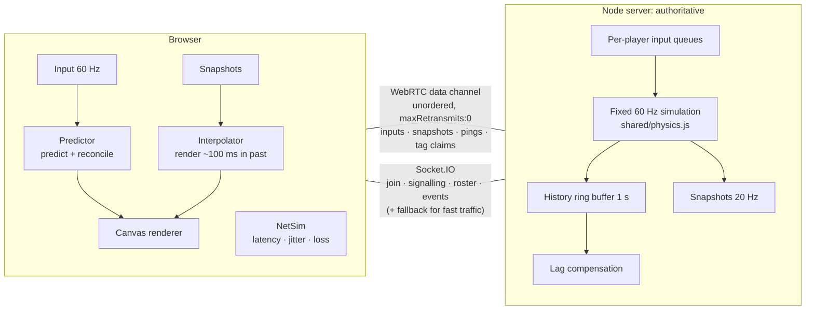

# LagTag

A 4-player browser tag game that doubles as an interactive demo of real-time game netcode.

You play tag in a small neon arena: whoever is **IT** chases, a touch passes it on, and the lowest time spent as IT after 90 seconds wins. Bots fill any empty seats, so one visitor alone still gets a full match.

The game has a built-in **Netcode Lab** panel. It lets you add latency, jitter and packet loss, then switch each technique off on its own, so you can see and feel what each one fixes.

```
npm install
npm start          # http://localhost:3000
npm test           # 16 tests: unit + WebSocket and WebRTC integration
```

Open the page in two browser windows, or send the **Copy invite** link to friends, to play humans against each other.

---

## Try this (2 minutes)

1. **Quick play**, then move around with WASD. It feels instant.
2. In the Netcode Lab, set **Added latency to 300 ms**. It still feels instant: that's *client-side prediction*.
3. Untick **Client-side prediction**. Every keypress now waits a full round trip before you move.
4. Turn prediction back on and untick **Server reconciliation**. You rubber-band, snapping back to stale server positions 20 times a second.
5. Untick **Entity interpolation**. Other players now stutter at the raw 20 Hz snapshot rate.
6. Tick **Show ghosts**. A dashed circle shows where the server thinks you are, and dotted circles show the raw latest snapshot of everyone else.
7. When you're IT with latency on, tag someone. An orange **"rewound 380 ms"** circle shows where the server rewound the target to validate your hit (*lag compensation*). Untick it and tags you clearly landed on screen start getting rejected.

---

## Architecture



### Why WebRTC *and* Socket.IO?

Fast-changing game state should be sent over UDP. If a snapshot is lost, the next one makes it obsolete 50 ms later anyway. Over TCP (WebSocket), one lost packet holds up every packet behind it until it is retransmitted (**head-of-line blocking**). Browsers can't open raw UDP sockets, but a WebRTC data channel created with `{ordered: false, maxRetransmits: 0}` gives the same semantics.

The server is a real WebRTC peer, built on [`node-datachannel`](https://github.com/murat-dogan/node-datachannel) (libdatachannel). It is **not** peer-to-peer, because the server must stay authoritative.

Socket.IO does everything that should be reliable or ordered: joining rooms, WebRTC offer/answer signalling, the roster, and tag and round events. If the data channel can't connect (no UDP, strict NAT, `DISABLE_RTC=1`), fast traffic falls back to *volatile* Socket.IO emits. Those are dropped rather than queued when the socket is backed up. The Lab shows which transport is active, and **Force WebSocket** lets you compare the two.

---

## The techniques, and where they live

| Technique | What it solves | Code |
|---|---|---|
| **Authoritative server, fixed timestep** | Single source of truth, cheat resistance, determinism. 60 Hz ticks catch up to wall time, so coarse OS timers (~15 ms on Windows) don't skew simulation time. | [server/room.js](server/room.js), [server/index.js](server/index.js) |
| **Shared deterministic physics** | The client must be able to replay exactly what the server will run. State is quantized each step, so a snapshot carries the server's *exact* state: on a clean network the reconciliation error is 0.0 px (asserted in tests). | [shared/physics.js](shared/physics.js) |
| **Client-side prediction** | Inputs apply locally right away; no round-trip wait. | [client/prediction.js](client/prediction.js) |
| **Server reconciliation** | Each snapshot acks input *N*. The client resets to the server state and replays inputs *N+1…latest*. Any leftover error (e.g. you got frozen by a tag) is smoothed out over ~70 ms instead of snapping. | [client/prediction.js](client/prediction.js) |
| **Input redundancy** | Every packet carries the last 12 unacked inputs, so losing a packet over the unreliable channel doesn't lose an input. The server deduplicates by sequence number. | [client/main.js](client/main.js), `Room.onInputs` |
| **Input credits** | A player can apply at most ~1 input per tick (with a small burst allowance for jitter), so a modified client can't speed-hack by sending extra inputs. | `Room.update` |
| **Entity interpolation** | Remote players are drawn `interpDelay` ms in the past, blended between the two snapshots around that time. Out-of-order snapshots are inserted in sorted order. If the buffer runs dry, it falls back to ≤120 ms of capped dead reckoning. | [client/interpolation.js](client/interpolation.js) |
| **Clock sync** | Pings measure RTT. The interpolation timeline is the *received* server time (max of `snapshotTs − arrival` over 1 s, the least-delayed packet), so the buffer holds `interpDelay` ms of data at any latency. It slews smoothly and backs off fast when starving. | [client/clock.js](client/clock.js) |
| **Lag compensation** | When you're IT, you see others ≈ RTT + 100 ms in the past. When your screen shows contact, the client sends a claim with the time it was rendering. The server waits for the inputs you'd applied, rewinds the target in a 1 s position history to that time, and validates the hit there ("favor the shooter"), capped at 500 ms. | `Room.processClaims`, [server/history.js](server/history.js) |
| **Network simulator** | Adds latency, jitter (which reorders packets) and loss to every packet in both directions. Reliable messages are delayed but never dropped or reordered. | [client/netsim.js](client/netsim.js) |

### Wire format

Snapshots are compact JSON arrays: `[id, x, y, vx, vy, dash, cooldown, dashX, dashY, frozen, lastAckedInput, itTicks, immune]`. With 4 players that's about 5 kB/s down and 2–7 kB/s up (depending on redundancy). A binary encoding would be the next step if this needed to scale.

---

## Project layout

```
shared/     constants + deterministic physics (imported by both server and browser)
server/     express + socket.io, rooms, bots, lag-comp history, WebRTC answerer
client/     no build step: plain ES modules + canvas
tests/      node:test: physics, prediction/reconciliation, interpolation,
            lag compensation, WebSocket and WebRTC integration
```

## Deploying

```
docker build -t lagtag . && docker run -p 3000:3000 lagtag
```

- Works anywhere Node 20+ runs. Without inbound UDP (e.g. Render, Heroku), WebRTC fails and the game falls back to WebSocket automatically.
- For the WebRTC path, run on a host that allows inbound UDP (a VPS, or Fly.io with UDP enabled). The server gathers its public address via STUN (`STUN_URL` overrides the default Google STUN server).
- `DISABLE_RTC=1` forces WebSocket only. `PORT` sets the HTTP port.

## License

MIT
# lagtag
